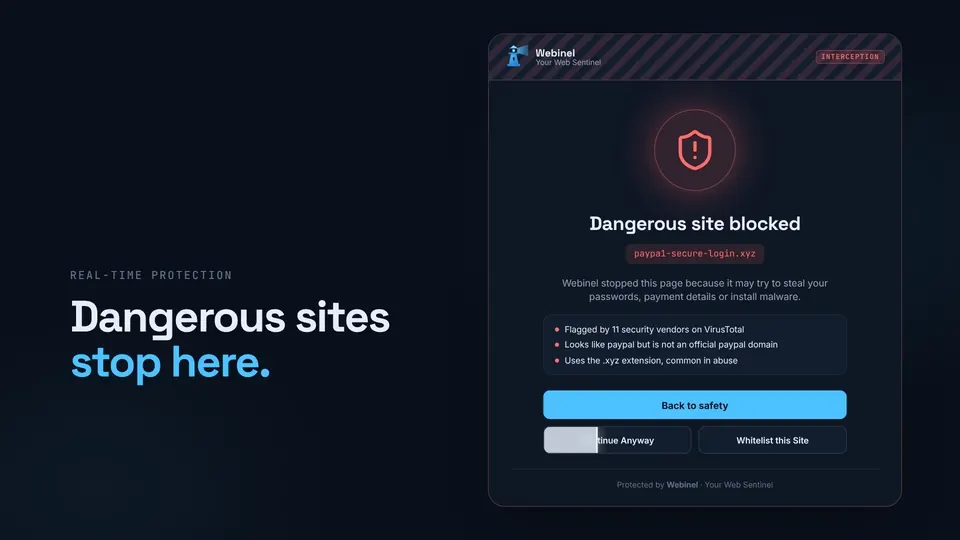
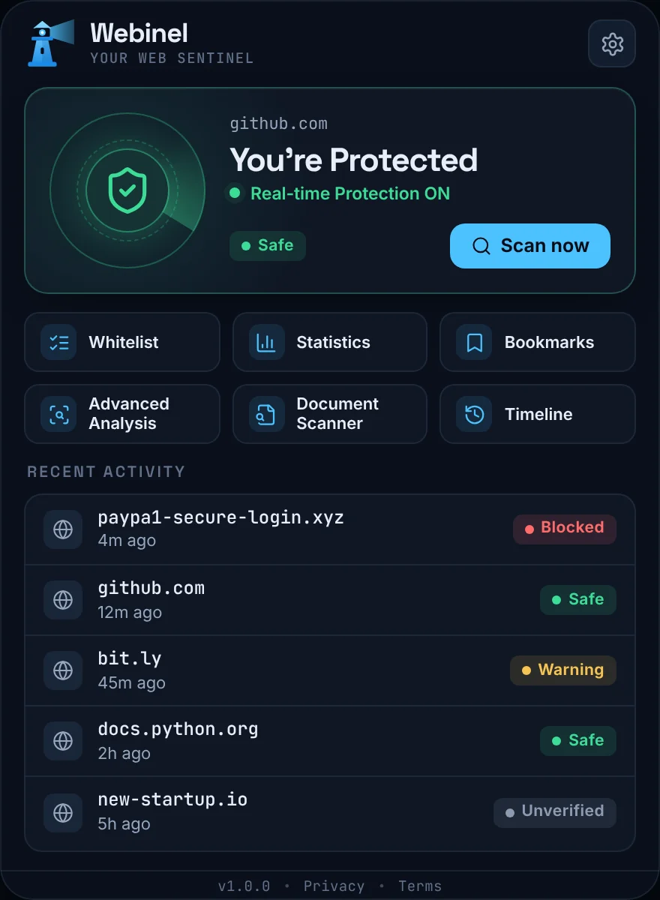
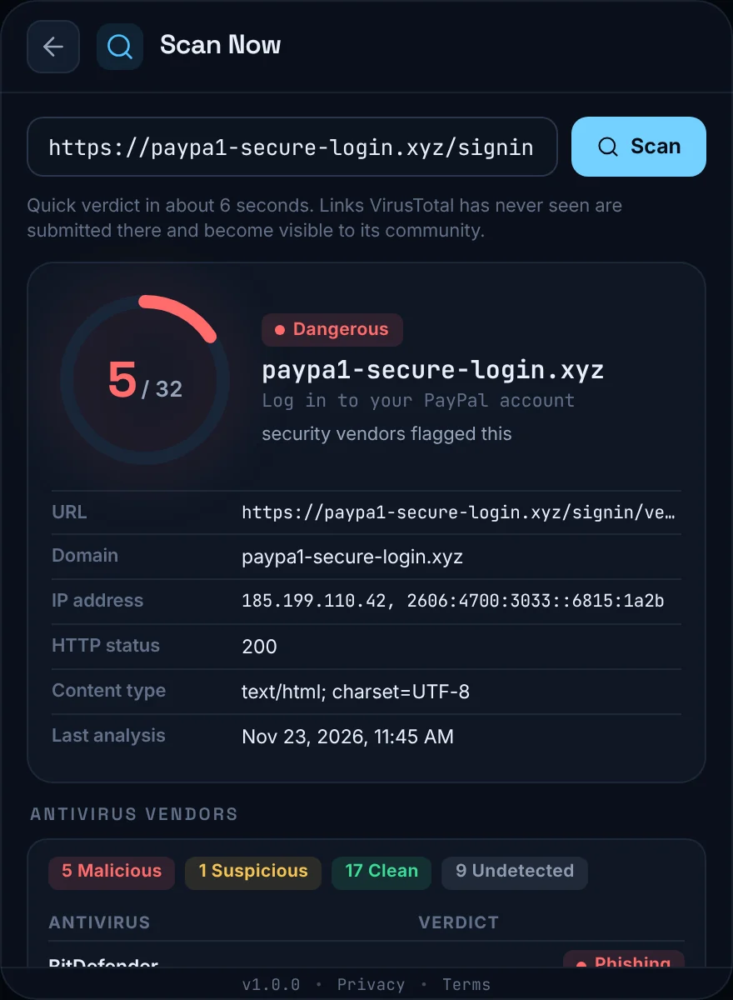
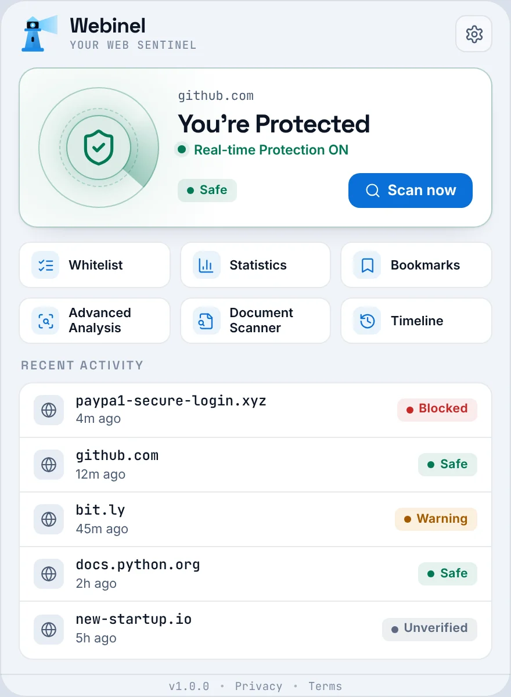
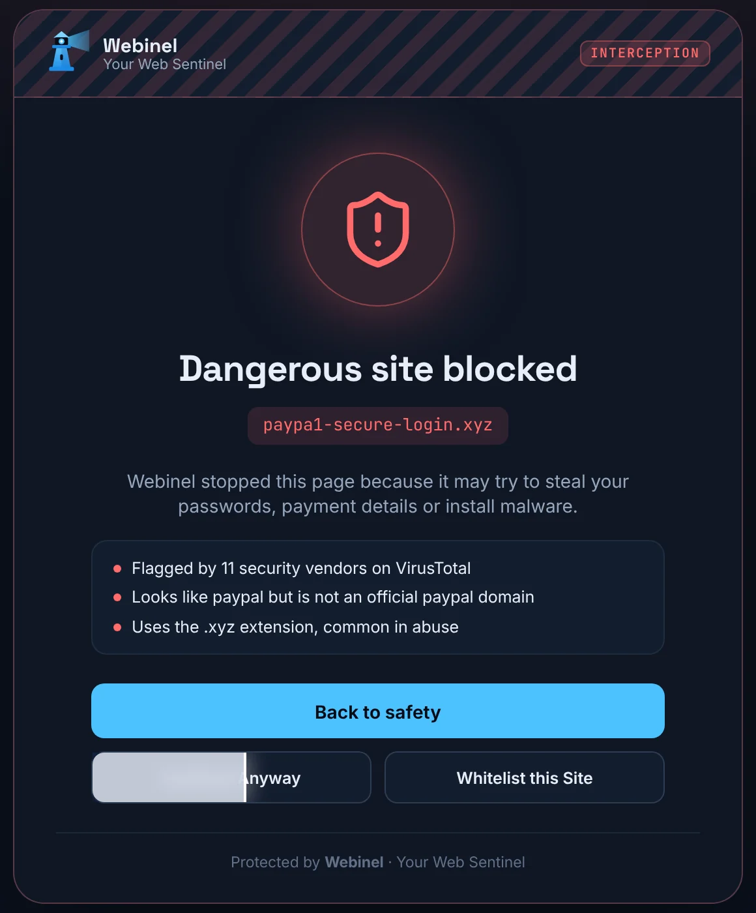
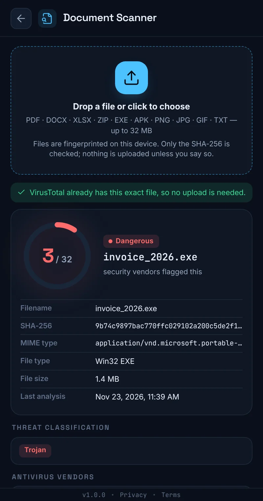
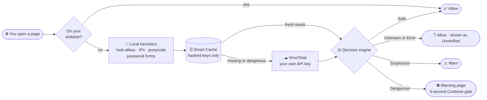
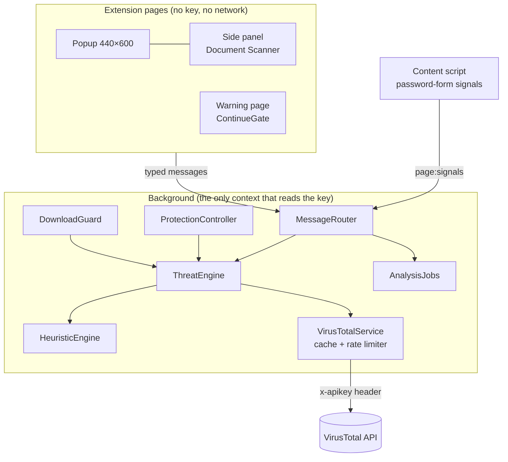

<div align="center">


<br />
<br />

<a href="https://jeevansai-k.github.io/webinel/#top" title="Watch the launch film in HD on the Webinel website">
  
</a>

<sub>▶ 20-second launch film, playing inline · <a href="media/launch.mp4">MP4 with soundtrack</a> · <a href="https://jeevansai-k.github.io/webinel/">website</a></sub>

# Webinel

### Your Web Sentinel. On watch while you browse.

**A privacy-first browser extension that stops phishing, look-alike domains and unsafe downloads before you click the wrong thing.**<br />
No account. No servers. No tracking. Free.

<br />

[](https://jeevansai-k.github.io/webinel/)
[](public/manifest.json)
[](tsconfig.json)
[](docs/TESTING.md)


[**Website**](https://jeevansai-k.github.io/webinel/) ·
[**Download**](https://jeevansai-k.github.io/webinel/download/webinel-1.0.0.zip) ·
[Quick start](#-quick-start) ·
[Install](#-install) ·
[How it works](#-how-it-works) ·
[Develop](#-development) ·
[Docs](#-deeper-reading)

</div>

---

> [!NOTE]
> **The night-watch log**, entry #1
> 23:41. Someone typed `paypa1-secure-login.xyz`. The second letter `l` was a `1`. Webinel noticed before the page finished loading, put up the red shield and kept **Continue Anyway** locked for three full seconds. Nobody lost a password tonight.

## 🔭 Watch report

|  |  |
|---|---|
| 🧠 **Thinks before you click** | Every page you open is checked locally first (look-alikes, raw IPs, punycode, risky forms), then against VirusTotal's 70+ engines with **your own** key. |
| 🔐 **Private by design** | No backend, no accounts, no telemetry. The API key is AES-GCM encrypted on your device. Cache keys are one-way hashes, so even the cache isn't a browsing history. |
| ⏳ **No rushing past threats** | Blocked pages lock **Continue Anyway** for exactly 3 seconds while a glass overlay drains like a health bar. |
| 🧩 **One edition** | No Premium, no trial. Every feature is in the one free download. |
| 🎨 **Nightwatch design** | Blue-ink surfaces, one signal-azure accent, a radar-sweep status card. Green, amber and red are reserved for verdicts. Auto, Dark and Light themes. |

## ✨ What Webinel does

<table>
<tr>
<td width="50%" valign="top">

### 🚦 Real-time protection
- Checks every page you open.
- Catches **look-alike and homoglyph domains** (`paypa1`, `rnicrosoft`), brand names on foreign domains, raw IP hosts, punycode tricks and risky TLDs.
- Flags **password forms** that post to another site or load over plain HTTP.
- **Dangerous → blocked** with a full-page warning. **Suspicious → flagged** (or blocked, if you choose).

### ⚡ Scan Now
- One click from Home, or paste any link (`host:port` works too).
- A VirusTotal verdict in about **6 seconds**: detection ratio, vendors, reputation, HTTP status and content type.

### 🔬 Advanced Analysis
- The **complete** VirusTotal report with no time limit, running in the background.
- Vendors, categories, redirect chain, DNS, SSL certificate, WHOIS and raw metadata.
- **Current site**, **email link** and **clipboard** scanners.

</td>
<td width="50%" valign="top">

### 📄 Document Scanner
- PDF, DOCX, XLSX, ZIP, EXE, APK, PNG, JPG, GIF and TXT, up to **32 MB**.
- Fingerprinted (SHA-256) **on your device**. Nothing is uploaded unless **you** press **Upload to VirusTotal**.
- Opens in the browser's **side panel** (Firefox sidebar / Chrome side panel), which stays open while you pick a file.

### 🛡 Download guard
- Cancels disguised programs like `invoice.pdf.exe`.
- Pauses risky downloads from unverified sources, including once the real file name is known.

### 🧰 And the rest of the watchtower
- **Whitelist**, **Secure Bookmarks** (re-checked before opening), **Timeline** and **Statistics**.
- **API health check**, popup-safe confirmations and a recoverable error screen.

</td>
</tr>
</table>

<div align="center">

&nbsp;

&nbsp;

<br />

&nbsp;

<br />
<sub>All screenshots use the dev preview's fictional sample data.</sub>
</div>

---

## 🚀 Quick start

**Just want to use it?** Grab the latest build from the website and load it unpacked:

```text
https://jeevansai-k.github.io/webinel/download/webinel-1.0.0.zip
```

**Want to hack on it?** You'll be running from source in four commands:

```bash
git clone https://github.com/jeevansai-k/webinel.git
```

```bash
cd webinel
```

```bash
npm ci
```

```bash
npm run build
```

`npm run build` type-checks the code and writes the ready-to-load extension to **`dist/`**:

```text
dist/
├── manifest.json        ← the browser loads this
├── background.js        ← service worker
├── content.js           ← page-signal collector
├── popup/index.html     ← the popup (and the side panel, with ?mode=panel)
├── warning/Warning.html ← the block page
├── assets/              ← bundled JavaScript, CSS and fonts
└── icons/               ← toolbar icons
```

### ✅ Requirements

| You need | Version | Why |
|---|---|---|
| [Node.js](https://nodejs.org/) | **20.19+** or **22.12+** | Builds the extension (required by Vite 8) |
| npm | Comes with Node.js | Installs the build tools |
| A browser | A current **Chromium** browser (Chrome, Edge, Brave, Opera, Vivaldi; 121+ recommended) **or Firefox 121+** | Runs the extension |
| A free [VirusTotal](https://www.virustotal.com/) account | — | API key for reputation checks (optional, recommended) |

---

## 📦 Install

<details open>
<summary><b>🟦 Chrome, Edge, Brave, Opera, Vivaldi</b></summary>

1. Open your browser's extensions page: `chrome://extensions`, `edge://extensions`, `brave://extensions`, `opera://extensions` or `vivaldi://extensions`.
2. Turn on **Developer mode** (top right; in Edge it's in the left sidebar).
3. Click **Load unpacked** and select the unzipped download, or the project's **`dist`** folder (the one containing `manifest.json`).
4. Pin Webinel: the puzzle-piece icon → the pin next to **Webinel**.
5. Add your VirusTotal key: see [First-run setup](#-first-run-setup).

> [!TIP]
> The card may warn about `background.scripts`, `browser_specific_settings` or `sidebar_action`. Those keys are for Firefox; Chromium ignores them, so the warning is harmless.

**Updating:** pull, run `npm run build`, then press **↻ reload** on the Webinel card.

</details>

<details>
<summary><b>🦊 Firefox 121+</b></summary>

**Option A: temporary install (quickest)**

1. Open `about:debugging#/runtime/this-firefox`.
2. Click **Load Temporary Add-on…** and select **`manifest.json`** inside the unzipped download or `dist/`.
3. Pin it: Extensions button → ⚙ next to **Webinel** → **Pin to Toolbar**.
4. Allow website access: `about:addons` → **Webinel** → **Permissions** → turn on **"Access your data for all websites"**. Real-time protection needs it.

> [!IMPORTANT]
> Firefox removes temporary add-ons when it closes. Repeat these steps after a restart, or use Option B. Firefox may also warn about the Chrome-only `side_panel` / `sidePanel` manifest entries; that's harmless.

**Option B: keep it installed**

Release Firefox only keeps **signed** add-ons:

- **Sign it:** zip `dist/` and submit it at [addons.mozilla.org](https://addons.mozilla.org/developers/) with the *"On your own"* distribution option. Install the signed `.xpi` from `about:addons` → ⚙ → **Install Add-on From File…**
- **Developer Edition, Nightly or ESR:** set `xpinstall.signatures.required` to **false** in `about:config`, then install the ZIP the same way.

```bash
cd dist && zip -r ../webinel.zip . && cd ..
```

</details>

## 🔑 First-run setup

1. Sign in at [virustotal.com](https://www.virustotal.com/), open your profile → **API key**, and copy it.
2. Webinel icon → ⚙ **Settings** → ✏ on the *VirusTotal API* card.
3. Paste the key and press **Save**. It's encrypted and stored **only on this device**; from now on you'll only see `••••••••••••••••`.
4. Press 🔄. You should see **Online · _N_ ms**.

Free keys allow **4 requests per minute and 500 per day**; the Smart Cache and rate limiter keep you inside them. Without a key, Webinel still runs its local heuristics, and anything it can't verify is shown as **Unverified**, never as Safe.

### 🧪 Try it safely

Paste this into a new tab. The `.invalid` domain is reserved and can never resolve, so no real site is visited:

```text
http://paypal.com.secure-login.verify-account.invalid/signin
```

Webinel rates it **Dangerous** and shows the warning page. Watch **Continue Anyway** unlock after 3 seconds.

---

## 🧬 How it works

Every navigation runs through the same pipeline, cheapest and most private check first:



| Verdict | When | What you see |
|---|---|---|
| ✅ **Safe** | VirusTotal reports it clean **and** the heuristics are calm | Green ✓ badge |
| ⚠ **Suspicious** | One vendor flags it as malicious, any flags it as suspicious, or the heuristic score is 40+ | Amber ! badge, or a block if *Block suspicious sites* is on |
| ⛔ **Dangerous** | Two or more vendors flag it as malicious, or the heuristic score is 75+ | Full-page warning |
| ❔ **Unverified** | VirusTotal has no data, or no key is set | Grey ? badge, **never** Safe |
| ❔ **Check failed** | VirusTotal couldn't be reached or refused the request | Grey ? badge, **never** Safe |

**Smart Cache rules:** URLs and domains stay fresh for 24 h, files for 7 days. Dangerous results are re-checked on every lookup, unknown results last 1 h, and failures are never cached. Entries hold **no addresses, domains or file names**.

### 🏗 Architecture at a glance



---

## 🔒 Privacy promises

- 🚫 **No** servers, accounts, sign-in, OAuth, telemetry or analytics.
- 🗝 Your API key is **AES-GCM encrypted**, stored locally, never synced, never logged, never displayed after saving, and sent **only** to VirusTotal in a request header.
- 🌍 Real-time protection sends VirusTotal only the **domain** of the page you open.
- 🔗 Links are submitted for new analysis only when **you** run *Scan Now* on an unseen link, or *Advanced Analysis*.
- 📄 Files never leave your device unless **you** press **Upload to VirusTotal**; otherwise only a SHA-256 fingerprint is checked.
- ✉ Email and clipboard scanners are **off by default**, run only when you press scan, and read **links only**.
- 🧹 No email bodies, clipboard contents or browsing history are ever stored.

Full details: [`docs/SECURITY.md`](docs/SECURITY.md), plus the in-app **Privacy** and **Terms** pages.

---

## 📁 Project structure

```text
webinel/
├── public/                 # manifest.json (MV3, Chromium + Firefox 121+), toolbar icons
├── src/
│   ├── api/                # VirusTotalClient (the only HTTP client) + JSON parsers
│   ├── background/         # service worker: router, protection, jobs, download guard, badge
│   ├── content/            # password-form signals (never reads page text)
│   ├── services/           # ThreatEngine, heuristics, decisions, cache, rate limiter, scanners
│   ├── storage/            # typed chrome.storage wrappers (never sync) + encrypted key store
│   ├── shared/             # components, design tokens (theme.css), icons, messages, errors
│   ├── popup/              # one folder per screen: .html · .css · .ts · .test.ts · README.md
│   ├── warning/            # block page + the 3-second ContinueGate
│   ├── utils/              # url, domain, hash, time, format, logger
│   └── assets/             # logo.svg (source artwork) and bundled fonts (SIL OFL)
├── tests/                  # integration · security · ui · fixtures · chrome.* mock
├── site/                   # the website, published to GitHub Pages
├── media/                  # launch film (MP4, animated WebP, poster)
├── preview/                # dev-only popup preview with a stubbed chrome API
├── scripts/build-icons.mjs # logo.svg → PNG icons (Playwright Chromium)
├── docs/                   # architecture, scanning engine, security, testing
└── .github/workflows/      # pages.yml: test, build, publish the site
```

<details>
<summary>Full source tree</summary>

```text
src/
├── api/            VirusTotalClient.ts · parsers.ts
├── background/     index.ts · MessageRouter.ts · ProtectionController.ts · AnalysisJobs.ts
│                   DownloadGuard.ts · RedirectTracker.ts · SessionState.ts · Badge.ts
├── content/        index.ts · sameSite.ts
├── services/       ThreatEngine · HeuristicEngine · DecisionEngine · VirusTotalService
│                   SmartCache · RateLimiter · UrlScanner · FileScanner · ReportBuilder
│                   HashService · UploadStaging · UrlValidation · FileValidation · LinkExtractor
├── storage/        LocalStore · SecretStore · Settings/Whitelist/Stats/Timeline/
│                   Activity/Bookmark/AnalysisJob stores
├── shared/         components/ (DetectionCircle, ResultHeader, VendorTable, MetadataGrid,
│                   AnalysisProgress, ErrorState, ReportViews, VerdictChip, ScreenHeader,
│                   Toast, ConfirmDialog) · styles/ · icons/ · messages · scan · verdict
│                   scanErrors · config · dom · theme
├── popup/          Home (+ ScanNow) · AdvancedAnalysis · DocumentScanner · Settings
│                   Statistics · Timeline · Whitelist · Bookmarks · Legal · router · main
└── warning/        Warning.html/.css/.ts · ContinueGate.ts
```

</details>

---

## 💻 Development

| Command | What it does |
|---|---|
| `npm run build` | Type-check, then build everything into `dist/` |
| `npm test` | Run the full test suite once |
| `npm run test:watch` | Re-run tests as you edit |
| `npm run typecheck` | TypeScript checks only |
| `npm run build:icons` | Regenerate the PNG icons from `src/assets/logo.svg` (Playwright Chromium) |

**Preview the popup in a normal tab (no install needed):**

```bash
npx vite --config vite.preview.config.ts
```

Open `http://localhost:5178/preview/popup.html`. Add `?screen=settings`, `?screen=advanced`, `?screen=documents`… or `?theme=light`, `&mode=panel` for the side-panel layout, or open `/preview/warning.html`. The preview runs on fictional sample data and never uses a real key.

**Stack:** TypeScript · Vite · Vitest + jsdom · plain HTML/CSS · **zero runtime dependencies**.

### 🧪 Testing

- **326** unit, integration, security and UI tests (`npm test`), with an in-memory `chrome.*` mock and fake clocks.
- The security suite pins the promises: the 3-second gate can't be skipped, the key never reaches a UI context, nothing uploads without consent, Scan Now never waits past 6 s, and Unknown is never Safe.
- Releases are also driven end to end in real Chromium (Playwright) against a fake VirusTotal: blocking, whitelisting, Scan Now and a full file upload in the side panel.

### 🌐 The website

The marketing site lives in [`site/`](site/): static HTML/CSS with the extension's own design tokens and fonts, and no external requests. Every push to `main` that touches the site or the extension runs [`.github/workflows/pages.yml`](.github/workflows/pages.yml). That workflow tests and builds the extension, puts a fresh `webinel-<version>.zip` behind the Download button, and publishes to the `gh-pages` branch for GitHub Pages.

### 📚 Deeper reading

[`docs/ARCHITECTURE.md`](docs/ARCHITECTURE.md) · [`docs/SCANNING_ENGINE.md`](docs/SCANNING_ENGINE.md) · [`docs/SECURITY.md`](docs/SECURITY.md) · [`docs/TESTING.md`](docs/TESTING.md) · each popup screen's own `README.md`.

---

## 🧭 Browser support

| | Chrome / Edge / Brave | Firefox 121+ |
|---|:---:|:---:|
| Real-time protection & warning page | ✅ | ✅ (allow site access) |
| Scan Now · Advanced Analysis | ✅ | ✅ |
| Document Scanner | ✅ side panel (popup on macOS) | ✅ sidebar |
| Download guard | ✅ | ✅ |
| Permanent install | Load unpacked | Signed add-on (or Dev/Nightly/ESR) |

## 🩺 Troubleshooting

| Symptom | Fix |
|---|---|
| **"Manifest file is missing or unreadable"** | You picked the project root. Pick **`dist`** (run `npm run build` first) or the unzipped download. |
| `npm ci` / `npm run build` fails immediately | `node --version` must be **20.19+** or **22.12+**. |
| **No key added** / *API key required* | Add your VirusTotal key: [First-run setup](#-first-run-setup). |
| **Invalid key** | Copy it again from your VirusTotal profile; it's 64 characters. |
| **Daily API limit reached** | Free keys allow 4/min and 500/day. Wait a minute; the daily quota resets at 00:00 UTC. |
| A finished upload waits before the report appears | That's the 4-requests-per-minute limit of free keys. The report arrives within the minute. |
| Firefox never shows warnings | `about:addons` → Webinel → **Permissions** → allow all websites, and check **Real-time Protection** in Settings. |
| Webinel vanished from Firefox | Temporary add-ons go when Firefox closes. Reload it, or see Option B. |
| Clicking the drop zone opens the side panel | Expected: browsers close toolbar popups while a file chooser is open, and the side panel stays open. Dragging a file onto the popup works too. |
| No **Upload to VirusTotal** button | VirusTotal already knows that exact file, so its report is shown and no upload is needed. |
| A bad page on a big shared site isn't blocked | Real-time checks look up the **domain** only, for privacy. Use **Scan Now** or **Advanced Analysis** for the full address. |

---

## 🗺 Roadmap

- [x] Real-time protection and the 3-second warning gate
- [x] Scan Now, Advanced Analysis and Document Scanner (side panel)
- [x] Smart Cache, rate limiting and encrypted key storage
- [x] Chromium and Firefox support · Nightwatch design · watchtower icon
- [x] Website on GitHub Pages and a launch film
- [ ] Chrome Web Store and addons.mozilla.org listings (signed Firefox build)
- [ ] Final Firefox add-on ID (`browser_specific_settings.gecko.id`)
- [ ] Legal review of the Privacy and Terms text
- [ ] Choose a license

## 🤝 Contributing

1. Fork the repository and create a branch.
2. Keep business logic in `src/services/` and UI in `src/popup/`; screens only render and send messages.
3. Run `npm run typecheck` and `npm test` before opening a pull request.
4. Reporting a false positive or a missed threat? Include the **domain** (never a private link) and what Webinel showed.

## 📬 Contact

- ✉ **Email:** [kukkalajeevansai@gmail.com](mailto:kukkalajeevansai@gmail.com), or **Settings → Contact Developer** inside the extension.
- 🐙 **GitHub:** [github.com/jeevansai-k](https://github.com/jeevansai-k)

## 🙏 Credits

- Reputation data by [VirusTotal](https://www.virustotal.com/) (your own free API key). Webinel isn't affiliated with VirusTotal.
- Fonts: [Inter](https://rsms.me/inter/), [Space Grotesk](https://floriankarsten.com/space-grotesk/) and [JetBrains Mono](https://www.jetbrains.com/lp/mono/), under the SIL Open Font License (see `src/assets/fonts/`).
- Launch film made with [`/brag`](https://github.com/latent-spaces/brag): real UI, original soundtrack.

## 📄 License

No license has been chosen yet, so all rights are reserved by the author for now. Choosing one is on the [roadmap](#-roadmap).

<div align="center">
<br />

<br />
<sub><i>Protect first. Respect privacy always.</i> The watch is on.</sub>
</div>
